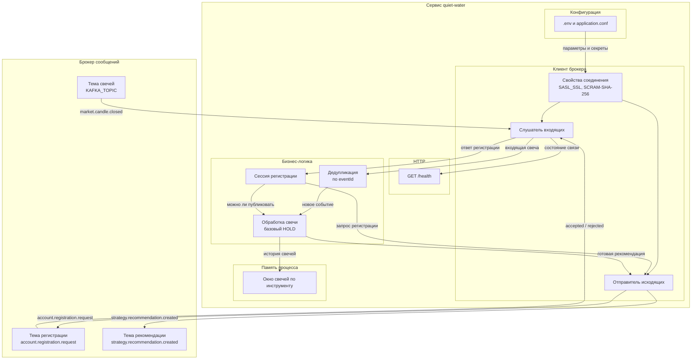

# Схема компонентов

Рядом с [контекстной схемой](context-diagram.md).
Здесь процесс `quiet-water` и темы, с которыми говорит его клиент. Люди и преподавательская платформа на эту схему не входят.

Отдельной базы нет: окно свечей живёт в памяти процесса. Опубликованный сигнал сейчас базовый `HOLD`. Модуль walk-forward и RSI в репозитории есть и в эту публикацию не входит.

| Слой | Что делает |
|---|---|
| Конфигурация | Собирает адрес брокера, темы, `group.id`, ключ и пороги из `.env`, окружения и `application.conf`. Секретов в Git нет |
| Клиент брокера | Слушает свечи и ответ регистрации, публикует запрос и рекомендацию. Обрыв соединения поднимает клиента снова и не останавливает процесс |
| Тема регистрации | Одна тема `account.registration.request`: туда уходит запрос и оттуда читаются `account.registration.accepted` и `account.registration.rejected` |
| Тема свечей | Имя задаёт преподаватель через `KAFKA_TOPIC`. Событие — `market.candle.closed` |
| Тема рекомендации | Событие `strategy.recommendation.created`. Тема — `KAFKA_OUTBOUND_TOPIC`, иначе тема свечей |
| Дедупликация | Повтор того же `eventId` вторую обработку не запускает |
| Сессия регистрации | Пока ответа нет, свечи копятся. После принятия уходит рекомендация. Отказ фиксирует причину и публикацию запрещает |
| Обработка свечи | Кладёт свечу в окно и собирает одну рекомендацию `HOLD`. Неполная свеча до окна не доходит |
| Память | Короткая история по инструменту в том же процессе. Отдельный сервер базы не запускается |
| GET /health | Без авторизации отдаёт `status`, `service`, `version` и `components`, в том числе состояние связи с брокером |
