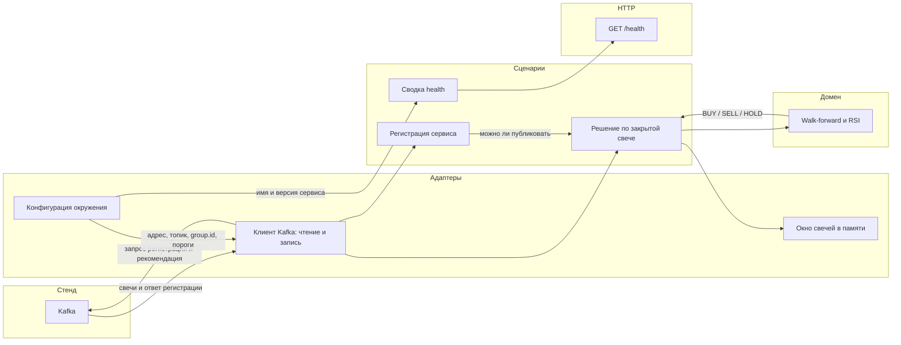

# Схема компонентов

Рядом с [проектным документом](project-description.md).
Показаны только основные части процесса, их ответственность и потоки данных.

| Часть | Ответственность |
|---|---|
| Конфигурация окружения | Адрес брокера, топик, свой `group.id`, пороги стратегии. Секретов в репозитории нет |
| Клиент Kafka | Подписка на `market.candle.closed`, запрос регистрации, публикация рекомендации. Обрыв брокера не останавливает процесс |
| Регистрация | Ждёт `account.registration.accepted`. При отказе фиксирует причину и запрещает публикацию |
| Окно в памяти | Короткая история свечей по тикеру. Отдельной базы в этом задании нет |
| Walk-forward и RSI | Фаза и сигнал. Не знает ни про HTTP, ни про Kafka |
| GET /health | Отдаёт `status`, `service`, `version`, `components` без авторизации |
