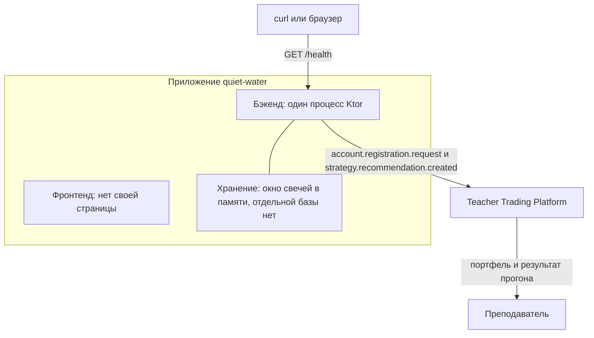

# Схема компонентов

Рядом с [проектным документом](project-description.md).
Здесь состав самого приложения: бэкенд, фронтенд и хранение. Внешняя платформа показана только как сосед, с которым говорит бэкенд.

Отдельного фронтенда и отдельной базы в этом репозитории нет. Портфель смотрят на платформе. Короткая история свечей живёт в памяти того же процесса, что и бэкенд, и пропадает при остановке.

| Часть | Есть в приложении | Как участвует |
|---|---|---|
| Фронтенд | нет | Своей страницы сервис не отдаёт. Проверка живости идёт сразу на бэкенд, портфель открывают на платформе |
| Бэкенд | да | Единственный процесс. Принимает `GET /health`, при старте отправляет регистрацию, по закрытой свече готовит одну рекомендацию |
| База данных | нет | Окно свечей хранит сам бэкенд в памяти. Отдельный сервер базы не запускается и с бэкендом не соединён |
| Платформа | снаружи приложения | Принимает регистрацию и рекомендацию и показывает результат преподавателю |
