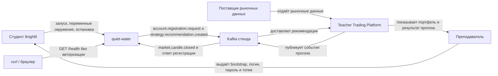

# Контекстная схема

Рядом с [проектным документом](project-description.md).
На схеме только внешние участники и направление обмена. Классы внутри процесса сюда не входят.

Пользователя личного кабинета у `quiet-water` нет: портфель смотрит преподаватель на платформе, сервис запускает студент.

| Откуда | Куда | Зачем |
|---|---|---|
| Преподаватель | Студент | Один раз выдаёт доступ к брокеру. В Git эти значения не попадают |
| Студент | quiet-water | Поднимает процесс и останавливает его |
| Поставщик данных | Платформа | Источник свечей. Напрямую к сервису не подключается |
| Платформа | Kafka | Кладёт закрытые свечи и ответ регистрации |
| Kafka | quiet-water | Сервис читает своим `group.id`, чтобы получить каждую свечу |
| quiet-water | Kafka | При старте просит регистрацию, затем публикует одно решение на свечу |
| Kafka | Платформа | Платформа забирает рекомендации и ведёт виртуальный портфель |
| Платформа | Преподаватель | Показывает портфель. Это не UI нашего сервиса |
| curl / браузер | quiet-water | Проверка живости. Авторизации нет |
