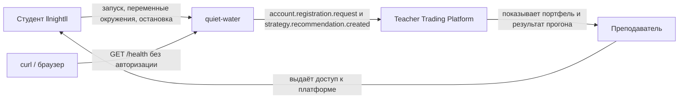

# Контекстная схема

Рядом с [проектным документом](project-description.md).
На схеме только внешние участники и направление обмена. Классы внутри процесса сюда не входят.

Пользователя личного кабинета у `quiet-water` нет: портфель смотрит преподаватель на платформе, сервис запускает студент.
Транспорт платформы на схеме не назван: сервис видит платформу, а не отдельный брокер.
Поставщик рыночных данных сюда не входит: к сервису он не подключён.

| Откуда | Куда | Зачем |
|---|---|---|
| Преподаватель | Студент | Один раз выдаёт доступ к платформе. В Git эти значения не попадают |
| Студент | quiet-water | Поднимает процесс и останавливает его |
| quiet-water | Платформа | При старте просит регистрацию, затем публикует одно решение на свечу |
| Платформа | Преподаватель | Показывает портфель. Это не UI нашего сервиса |
| curl / браузер | quiet-water | Проверка живости. Авторизации нет |
