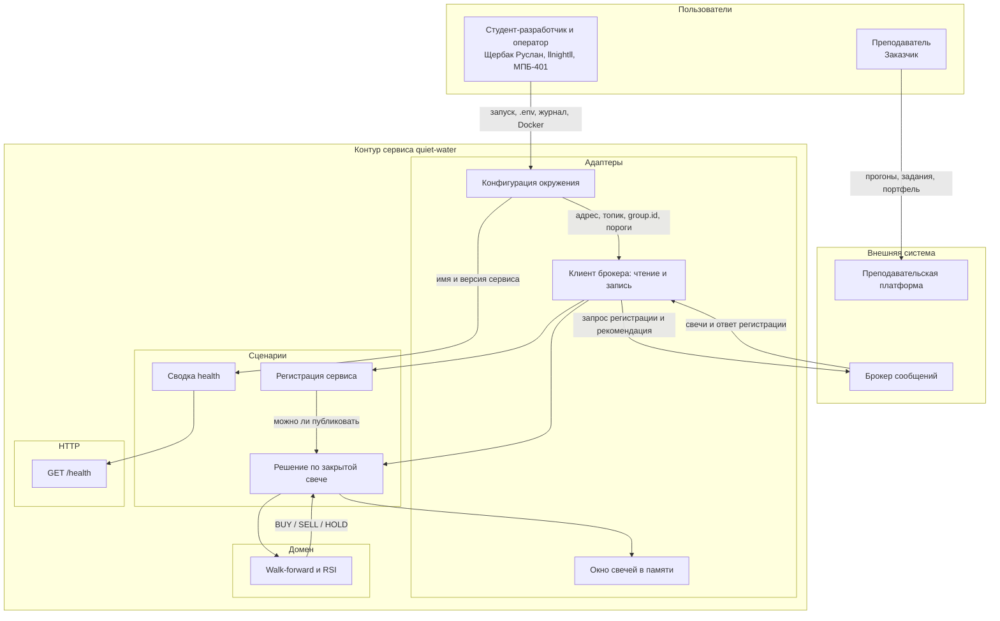

# Контекстная схема

Рядом с [проектным документом](project-description.md).
Снаружи известна преподавательская платформа. Канал обмена — брокер сообщений, продукт на схеме не назван. Устройство платформы сюда не входит.

Контур `quiet-water` показан целиком: один процесс, без своей страницы. Портфель открывают на платформе. Окно свечей лежит в памяти этого процесса и пропадает при остановке. Слои внутри процесса — на [схеме компонентов](component-diagram.md).

| Часть | Ответственность |
|---|---|
| Конфигурация окружения | Адрес брокера, топик, свой `group.id`, пороги стратегии. Секретов в репозитории нет |
| Клиент брокера | Подписка на `market.candle.closed`, запрос регистрации, публикация рекомендации. Обрыв брокера не останавливает процесс |
| Регистрация | Ждёт `account.registration.accepted`. При отказе фиксирует причину и запрещает публикацию |
| Окно в памяти | Короткая история свечей по тикеру. Отдельной базы нет |
| Walk-forward и RSI | Фаза и сигнал. Не знает ни про HTTP, ни про брокер |
| GET /health | Отдаёт `status`, `service`, `version`, `components` без авторизации |

| Часть | Есть в приложении | Как участвует |
|---|---|---|
| Фронтенд | нет | Своей страницы сервис не отдаёт. Проверка живости идёт на `GET /health`, портфель открывают на платформе |
| Бэкенд | да | Единственный процесс: адаптеры, сценарии, домен и HTTP |
| База данных | нет | Окно свечей хранит сам процесс в памяти |
| Платформа и брокер | снаружи | Платформа ведёт прогон и портфель. Брокер доставляет регистрацию, свечи и рекомендацию |
