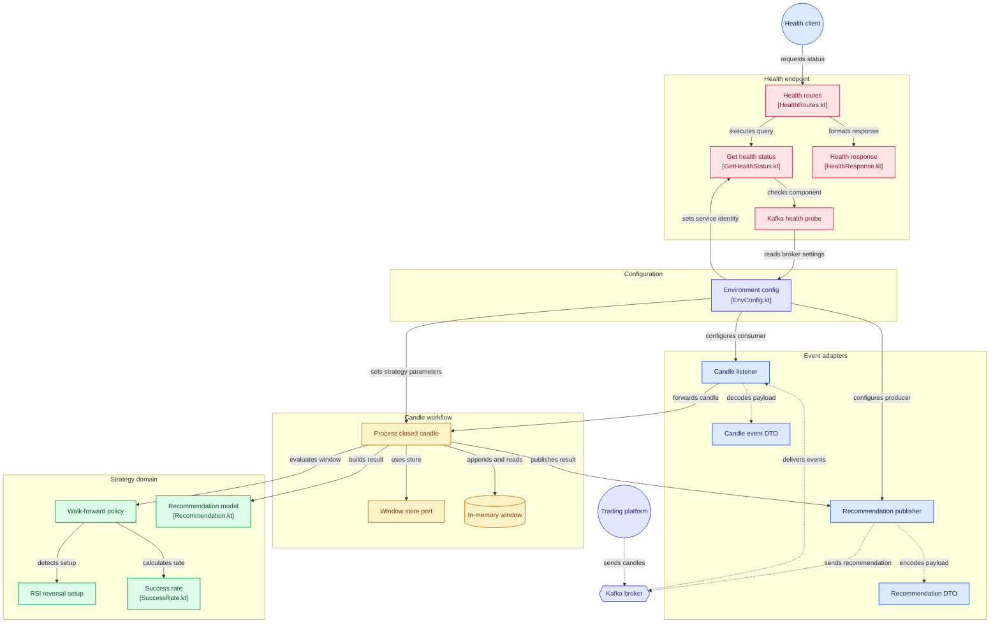

# Схема GitDiagram

Интерактивная схема, она же источник автообновления: https://gitdiagram.com/team-reboot-academy/quiet-water

Текст между метками подставляет [workflow](../.github/workflows/update-gitdiagram.yml) из markdown-версии этой страницы. Этот блок вручную не правят.

<!-- gitdiagram:start -->
# team-reboot-academy/quiet-water architecture

> Architecture diagram of the GitHub repository team-reboot-academy/quiet-water, generated by GitDiagram from its file tree, README and a sample of source files (last updated 2026-10-12). It is an AI-made overview: check details against the source.

- Interactive diagram: https://gitdiagram.com/team-reboot-academy/quiet-water
- Repository: https://github.com/team-reboot-academy/quiet-water

## Overview

Quiet Water is a Kotlin strategy service for the Teacher Trading Platform: it consumes closed-candle events, builds per-instrument windows, evaluates a walk-forward RSI strategy, and publishes BUY/SELL/HOLD recommendations. A separate health path reports service and Kafka status over HTTP. The README documents the strategy stages and Kafka role; source excerpts show application wiring and candle-processing calls. Some adapter internals were not excerpted, so their connections are included only where the SOURCE INDEX or README supports them.

## Diagram (Mermaid)

## Components

### Event adapters

- [Candle listener](https://github.com/team-reboot-academy/quiet-water/blob/main/src/main/kotlin/ru/omsu/quietwater/adapter/kafka/inbound/KafkaCandleListener.kt): `src/main/kotlin/ru/omsu/quietwater/adapter/kafka/inbound/KafkaCandleListener.kt`
- [Candle event DTO](https://github.com/team-reboot-academy/quiet-water/blob/main/src/main/kotlin/ru/omsu/quietwater/adapter/kafka/dto/CandlePayloadDto.kt): `src/main/kotlin/ru/omsu/quietwater/adapter/kafka/dto/CandlePayloadDto.kt`
- [Recommendation publisher](https://github.com/team-reboot-academy/quiet-water/blob/main/src/main/kotlin/ru/omsu/quietwater/adapter/kafka/outbound/KafkaRecommendationPublisher.kt): `src/main/kotlin/ru/omsu/quietwater/adapter/kafka/outbound/KafkaRecommendationPublisher.kt`
- [Recommendation DTO](https://github.com/team-reboot-academy/quiet-water/blob/main/src/main/kotlin/ru/omsu/quietwater/adapter/kafka/dto/RecommendationPayloadDto.kt): `src/main/kotlin/ru/omsu/quietwater/adapter/kafka/dto/RecommendationPayloadDto.kt`

### Candle workflow

- [Process closed candle](https://github.com/team-reboot-academy/quiet-water/blob/main/src/main/kotlin/ru/omsu/quietwater/application/candle/ProcessClosedCandle.kt): `src/main/kotlin/ru/omsu/quietwater/application/candle/ProcessClosedCandle.kt`
- [Window store port](https://github.com/team-reboot-academy/quiet-water/blob/main/src/main/kotlin/ru/omsu/quietwater/application/port/outbound/InstrumentWindowStore.kt): `src/main/kotlin/ru/omsu/quietwater/application/port/outbound/InstrumentWindowStore.kt`
- [In-memory window](https://github.com/team-reboot-academy/quiet-water/blob/main/src/main/kotlin/ru/omsu/quietwater/adapter/persistence/InMemoryInstrumentWindowStore.kt): `src/main/kotlin/ru/omsu/quietwater/adapter/persistence/InMemoryInstrumentWindowStore.kt`

### Strategy domain

- [Walk-forward policy](https://github.com/team-reboot-academy/quiet-water/blob/main/src/main/kotlin/ru/omsu/quietwater/domain/walkforward/WalkForwardPolicy.kt): `src/main/kotlin/ru/omsu/quietwater/domain/walkforward/WalkForwardPolicy.kt`
- [RSI reversal setup](https://github.com/team-reboot-academy/quiet-water/blob/main/src/main/kotlin/ru/omsu/quietwater/domain/setup/RsiReversalSetup.kt): `src/main/kotlin/ru/omsu/quietwater/domain/setup/RsiReversalSetup.kt`
- [Success rate](https://github.com/team-reboot-academy/quiet-water/blob/main/src/main/kotlin/ru/omsu/quietwater/domain/score/SuccessRate.kt): `src/main/kotlin/ru/omsu/quietwater/domain/score/SuccessRate.kt`
- [Recommendation model](https://github.com/team-reboot-academy/quiet-water/blob/main/src/main/kotlin/ru/omsu/quietwater/domain/recommendation/Recommendation.kt): `src/main/kotlin/ru/omsu/quietwater/domain/recommendation/Recommendation.kt`

### Health endpoint

- [Health routes](https://github.com/team-reboot-academy/quiet-water/blob/main/src/main/kotlin/ru/omsu/quietwater/api/health/HealthRoutes.kt): `src/main/kotlin/ru/omsu/quietwater/api/health/HealthRoutes.kt`
- [Get health status](https://github.com/team-reboot-academy/quiet-water/blob/main/src/main/kotlin/ru/omsu/quietwater/application/health/GetHealthStatus.kt): `src/main/kotlin/ru/omsu/quietwater/application/health/GetHealthStatus.kt`
- [Kafka health probe](https://github.com/team-reboot-academy/quiet-water/blob/main/src/main/kotlin/ru/omsu/quietwater/adapter/health/KafkaHealthProbe.kt): `src/main/kotlin/ru/omsu/quietwater/adapter/health/KafkaHealthProbe.kt`
- [Health response](https://github.com/team-reboot-academy/quiet-water/blob/main/src/main/kotlin/ru/omsu/quietwater/api/dto/HealthResponse.kt): `src/main/kotlin/ru/omsu/quietwater/api/dto/HealthResponse.kt`

### Configuration

- [Environment config](https://github.com/team-reboot-academy/quiet-water/blob/main/src/main/kotlin/ru/omsu/quietwater/adapter/config/EnvConfig.kt): `src/main/kotlin/ru/omsu/quietwater/adapter/config/EnvConfig.kt`

### Other components

- **Trading platform**
- **Kafka broker**
- **Health client**

## Connections

- Trading platform → Kafka broker: sends candles (evidence: `README.md`)
- Kafka broker → Candle listener: delivers events (evidence: `README.md`)
- Candle listener → Candle event DTO: decodes payload
- Candle listener → Process closed candle: forwards candle (evidence: `src/main/kotlin/ru/omsu/quietwater/adapter/kafka/inbound/KafkaCandleListener.kt`)
- Process closed candle → Window store port: uses store (evidence: `src/main/kotlin/ru/omsu/quietwater/application/candle/ProcessClosedCandle.kt`)
- Process closed candle → In-memory window: appends and reads (evidence: `src/main/kotlin/ru/omsu/quietwater/application/candle/ProcessClosedCandle.kt`)
- Process closed candle → Walk-forward policy: evaluates window (evidence: `src/main/kotlin/ru/omsu/quietwater/application/candle/ProcessClosedCandle.kt`)
- Walk-forward policy → RSI reversal setup: detects setup (evidence: `src/main/kotlin/ru/omsu/quietwater/domain/walkforward/WalkForwardPolicy.kt`)
- Walk-forward policy → Success rate: calculates rate (evidence: `src/main/kotlin/ru/omsu/quietwater/domain/walkforward/WalkForwardPolicy.kt`)
- Process closed candle → Recommendation model: builds result (evidence: `src/main/kotlin/ru/omsu/quietwater/application/candle/ProcessClosedCandle.kt`)
- Process closed candle → Recommendation publisher: publishes result (evidence: `src/main/kotlin/ru/omsu/quietwater/application/candle/ProcessClosedCandle.kt`)
- Recommendation publisher → Recommendation DTO: encodes payload
- Recommendation publisher → Kafka broker: sends recommendation (evidence: `README.md`)
- Health client → Health routes: requests status (evidence: `src/main/kotlin/ru/omsu/quietwater/api/health/HealthRoutes.kt`)
- Health routes → Get health status: executes query (evidence: `src/main/kotlin/ru/omsu/quietwater/api/health/HealthRoutes.kt`)
- Get health status → Kafka health probe: checks component (evidence: `src/main/kotlin/ru/omsu/quietwater/application/health/GetHealthStatus.kt`)
- Health routes → Health response: formats response (evidence: `src/main/kotlin/ru/omsu/quietwater/api/health/HealthRoutes.kt`)
- Kafka health probe → Environment config: reads broker settings (evidence: `src/main/kotlin/ru/omsu/quietwater/adapter/health/KafkaHealthProbe.kt`)
- Environment config → Candle listener: configures consumer (evidence: `src/main/kotlin/ru/omsu/quietwater/QuietWaterApplication.kt`)
- Environment config → Recommendation publisher: configures producer (evidence: `src/main/kotlin/ru/omsu/quietwater/QuietWaterApplication.kt`)
- Environment config → Process closed candle: sets strategy parameters (evidence: `src/main/kotlin/ru/omsu/quietwater/QuietWaterApplication.kt`)
- Environment config → Get health status: sets service identity (evidence: `src/main/kotlin/ru/omsu/quietwater/QuietWaterApplication.kt`)
<!-- gitdiagram:end -->
